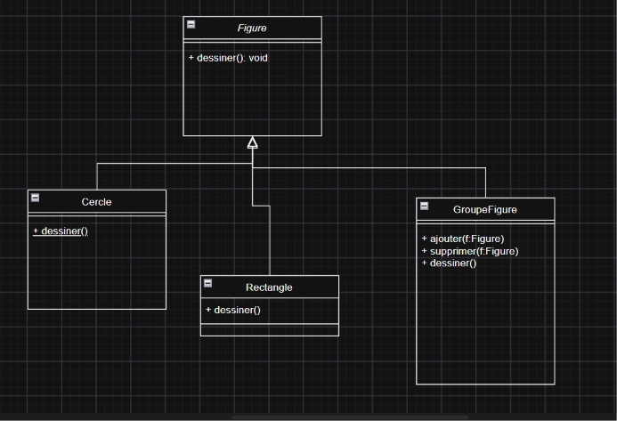
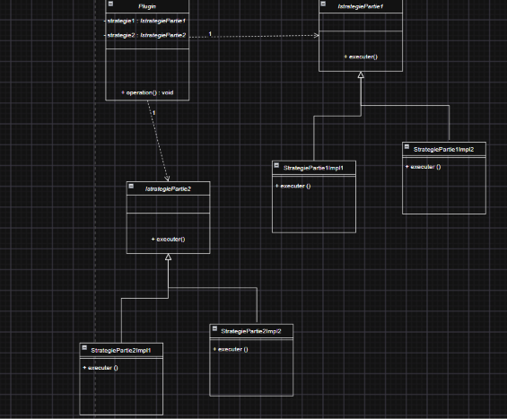
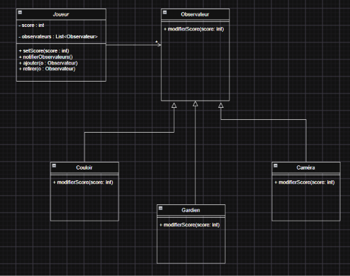

# Design Patterns — Exercices de Mohamed Youssfi

## Présentation

Ce dossier regroupe les solutions des exercices du travail à rendre sur les **Design Patterns**, dans le cadre du cours de Mohamed Youssfi.

L'objectif est d'identifier le patron de conception adapté à chaque situation et de représenter sa structure à travers des diagrammes de classes UML.

## Exercices réalisés

### Exercice 1 — Composite

**Problème :** une figure peut être un cercle, un rectangle ou un groupe de figures.

**Solution :** le pattern Composite permet de traiter uniformément les figures individuelles et les groupes de figures.

**Principaux éléments :**
- `Figure` : composant commun.
- `Cercle` : figure concrète.
- `Rectangle` : figure concrète.
- `GroupeFigure` : composite contenant plusieurs figures.

---

### Exercice 2 — Strategy

**Problème :** un plugin exécute un algorithme composé de deux parties variables, que le développeur doit pouvoir implémenter indépendamment.

**Solution :** le pattern Strategy encapsule les comportements variables derrière des interfaces, permettant de les fournir au plugin par composition.

**Principaux éléments :**
- `Plugin` : utilise les deux stratégies.
- `Partie1` : interface de la première stratégie.
- `Partie2` : interface de la deuxième stratégie.
- `Partie1Concrete` : implémentation concrète de la première stratégie.
- `Partie2Concrete` : implémentation concrète de la deuxième stratégie.

**Remarque :** Template Method constitue également une solution adaptée lorsque l'on souhaite définir le squelette de l'algorithme dans une classe abstraite. Une fabrique peut compléter la solution si le client doit instancier le plugin sans connaître sa classe concrète.

---

### Exercice 3 — Decorator

**Problème :** ajouter des responsabilités avant et après l'exécution de `traitement()` sans modifier le code source du composant existant.

**Solution :** le pattern Decorator enveloppe le composant et ajoute des traitements supplémentaires tout en conservant la même interface.

**Principaux éléments :**
- `IComposant` : interface commune.
- `ComposantConcret` : composant d'origine.
- `DecorateurAbstrait` : conserve une référence vers un composant.
- `DecorateurConcret` : ajoute les traitements avant et après l'exécution.

---

### Exercice 4 — Observer

**Problème :** informer automatiquement les objets `Couloir`, `Caméra` et `Gardien` chaque fois que le score du joueur change, tout en maintenant un couplage faible.

**Solution :** le pattern Observer permet à un sujet de notifier ses observateurs lorsqu'un changement d'état survient.

**Principaux éléments :**
- `Joueur` : sujet observable qui possède le score.
- `Observateur` : interface de notification.
- `Couloir` : observateur concret.
- `Camera` : observateur concret.
- `Gardien` : observateur concret.

---

## Synthèse

| Exercice | Design Pattern | Objectif principal |
|---|---|---|
| 1 | Composite | Organiser des objets en structures arborescentes |
| 2 | Strategy | Encapsuler et échanger des comportements variables |
| 3 | Decorator | Ajouter des responsabilités sans modifier le composant |
| 4 | Observer | Notifier automatiquement les objets intéressés par un changement d'état |

